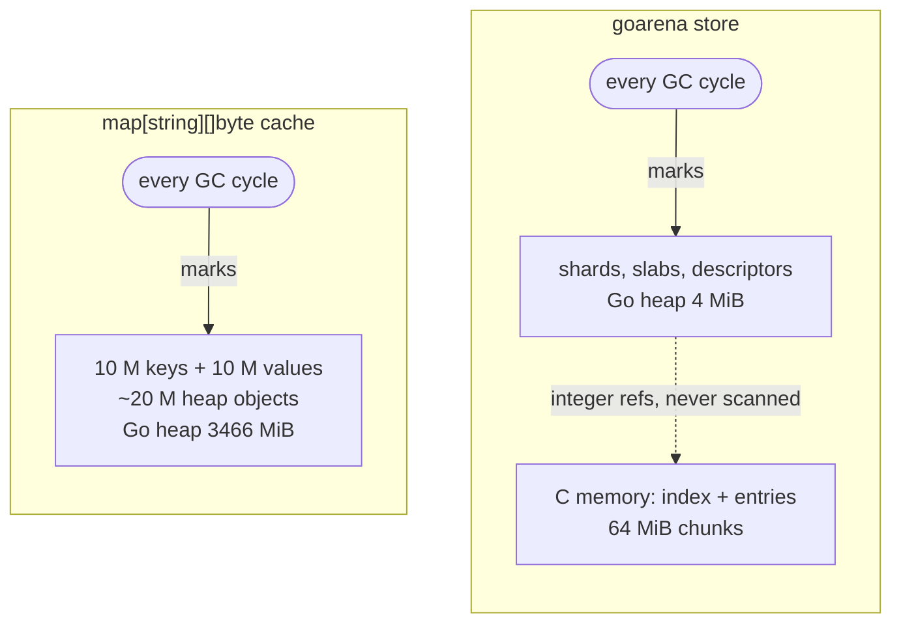

# goarena

**Off-heap memory for Go: keep millions of cache entries outside the garbage
collector's reach, so GC work and memory stop growing with your data.**

[](https://github.com/vladislavprovich/goarena/actions/workflows/ci.yml)
[](https://pkg.go.dev/github.com/vladislavprovich/goarena)
[](go.mod)
[](LICENSE)

goarena is a concurrent key-value store whose entries **and** hash index live
in memory obtained from C through cgo, plus the arena and size-class
allocators it is built on. The Go collector sees only a few MiB of
bookkeeping, whether the store holds one million entries or fifty: at 10
million entries a full GC cycle takes 0.45 ms instead of 316 ms for a
`map[string][]byte`, with 39 % more throughput and 4x lower p99.9 latency. It
uses only the standard library, reads without locks, and falls back to a
pure-Go mode when cgo is not available.

```go
s, _ := store.New(store.Config{})      // 256 shards, 64 MiB chunks
defer s.Close()                        // off-heap memory is freed explicitly

_ = s.Set([]byte("user:42"), []byte(`{"name":"Ada"}`))
buf, ok := s.GetInto(buf[:0], []byte("user:42")) // lock-free, zero allocations
```

## Contents

[Why goarena](#why-goarena) ·
[Features](#features) ·
[Quick start](#quick-start) ·
[Installation](#installation) ·
[When to use it](#when-to-use-it) ·
[Performance](#performance) ·
[Usage](#usage) ·
[Safety rules](#safety-rules) ·
[Documentation](#documentation) ·
[FAQ](#faq) ·
[Contributing](#contributing) ·
[License](#license)

## Why goarena

The Go GC is concurrent and its pauses are short, but every cycle must
**mark every live object that contains pointers**. A cache with ten million
`map[string][]byte` entries is about twenty million heap objects that the
collector traces again and again; GC CPU time, mark assists on the request
path, tail latency and RSS (about twice the live heap with `GOGC=100`) all
scale with the size of the cache, not with the request rate.

goarena moves that data out of the Go heap. The collector no longer marks it,
does not count it towards the heap goal, and the process needs no GC headroom
for it.



The price: memory is freed explicitly with `Close`, values are copied in and
out (or read in place under a lock with `View`), values are bytes, and a C
compiler is needed for the off-heap mode.

## Features

- **Off-heap entries and index** - the Go heap stays at a few MiB regardless
  of the number of entries; one full GC cycle stays below 1 ms even at 50 M
  entries.
- **Lock-free reads** - seqlock-validated reads that never write shared memory:
  hot keys scale across cores (48.66 Mops/s under a Zipf distribution).
- **Zero-allocation and zero-copy reads** - `GetInto` reuses your buffer,
  `View` reads in place.
- **TTLs** per entry or per store, with `EvictExpired` to free expired memory.
- **Cache-aside helpers** - `GetOrSet` (atomic set-if-absent) and
  `GetOrLoad` (load on miss, outside of any lock).
- **Memory limit** - `MaxMemory` with actionable `ErrNoMemory` errors; exact
  statistics (`Stats`, with a one-line `String()` for logs).
- **GC pacing** - `Config.GCPacing` makes `GOGC` and `GOMEMLIMIT` account for
  the off-heap data (package `gcpace`).
- **Typed arenas** - `arena.NewSlice[T]` / `NewValue[T]` for pointer-free
  structs, a 201-class `Slab` allocator for variable-sized blocks.
- **Works without cgo** - with `CGO_ENABLED=0` the same API runs on pointer-free
  Go-heap blocks (`arena.OffHeap == false`).
- **Standard library only**, tested with the race detector, a differential
  fuzz test, leak and stress tests on Linux, Windows and macOS.

## Quick start

```sh
go get github.com/vladislavprovich/goarena@latest
```

```go
package main

import (
	"fmt"
	"log"
	"time"

	"github.com/vladislavprovich/goarena/store"
)

func main() {
	s, err := store.New(store.Config{GCPacing: true}) // GCPacing: recommended for services
	if err != nil {
		log.Fatal(err)
	}
	defer s.Close() // returns every off-heap byte; the GC does not

	_ = s.SetString("greeting", "hello, off-heap world")
	_ = s.SetStringWithTTL("session:1", "token", time.Hour)

	v, _ := s.GetString("greeting") // a copy
	fmt.Println(v, s.HasString("session:1"))

	user, err := s.GetOrLoad([]byte("user:42"), func() ([]byte, error) {
		return []byte(`{"name":"Ada"}`), nil // e.g. a database query, called on a miss
	})
	fmt.Println(string(user), err)
	fmt.Println(s.Stats()) // one-line summary
}
```

More: `go run ./examples/quickstart` and the
[runnable examples on pkg.go.dev](https://pkg.go.dev/github.com/vladislavprovich/goarena/store#pkg-examples).

## Installation

Requirements: **Go 1.27+** and, for off-heap memory, **cgo**: `CGO_ENABLED=1`
and a C compiler in `PATH`.

| OS | C compiler |
|---|---|
| Linux | `sudo apt install build-essential` (Debian/Ubuntu), `sudo dnf install gcc` (Fedora), `apk add build-base` (Alpine) |
| macOS | Xcode Command Line Tools: `xcode-select --install` |
| Windows | 64-bit [MinGW-w64](https://www.mingw-w64.org/) GCC (for example from [WinLibs](https://winlibs.com/) or MSYS2), with its `bin` directory in `PATH` |

Check the setup:

```sh
go env CGO_ENABLED   # must print 1
gcc --version        # or: go env CC
```

<details>
<summary><b>Without cgo (CGO_ENABLED=0)</b></summary>

goarena also builds without a C compiler - for example when cross-compiling
or in `scratch` images. It then uses a pure-Go fallback: the same API and
behaviour, but the data lives in pointer-free Go-heap blocks. The GC still
does not scan them, but they count towards the heap goal and `GOMEMLIMIT`,
so the main benefits are lost; `Stats.OffHeapBytes` is 0 and `GCPacing` has
no effect. Check the mode at start-up:

```go
if !arena.OffHeap {
	log.Print("goarena built without cgo: data is kept in the Go heap")
}
```

Note that the `go` command disables cgo silently when it finds no C compiler,
and always when cross-compiling. See [GUIDE.md](docs/GUIDE.md#builds-without-cgo)
and [TROUBLESHOOTING.md](docs/TROUBLESHOOTING.md#cgo-is-not-enabled).

</details>

## When to use it

| use goarena for | do not use goarena for |
|---|---|
| in-memory caches with **1M - 100M+** entries | small data sets (< ~100k entries): a `map` is fine |
| session stores, rate-limit windows (TTL) | data that must persist, or transactions |
| lookup/dictionary tables, deduplication sets | caches that must **evict by themselves** (LRU/LFU) |
| read-heavy and hot-key workloads | values that are Go structs with pointers (needs serialization) |
| latency-sensitive services, tight container memory | mostly very large values (>= 4 KiB): the gains vanish |
| feature stores, read-mostly reference data | builds that cannot use cgo but need the off-heap benefits |

Every row with reasons, numbers and recommended alternatives:
[docs/USE_CASES.md](docs/USE_CASES.md) (includes a decision flowchart).

## Performance

AMD Ryzen 7 7735HS (8 cores / 16 threads), 32 GB, Windows 10, Go 1.24.6,
GCC 14.2; 16 goroutines, 90 % reads, 20-byte keys, 128-byte values, every run
in its own process, means of 3 runs. **N = 10 million entries:**

| metric | `map` + RWMutex | `sync.Map` | bigcache-style | **goarena** |
|---|---|---|---|---|
| throughput, Mops/s | 23.36 | 10.93 | 25.38 | **32.37** |
| latency p99 / p99.9, µs | 1.94 / 17.83 | 2.55 / 21.59 | 1.67 / 28.67 | **0.90 / 4.36** |
| GC CPU, % | 5.69 | 15.72 | 0.00 | **0.00** |
| one full GC cycle, ms | 316 | 1475 | 2.4 | **0.45** |
| Go heap, MiB | 3466 | 6274 | 1914 | **4** |
| process RSS, MiB | 4050 | 6538 | 1912 | **1797** |

<details>
<summary><b>More results: scale, hot keys, writes, services</b></summary>

| scenario | result |
|---|---|
| 50 M entries | goarena 25.57 Mops/s, 8.5 GiB RSS, 0.7 ms full GC; `map` 18.40 Mops/s, 15.0 GiB, 12.5 s |
| Zipf s = 1.1 (hot keys), N = 5 M | goarena 48.66 Mops/s, p99.9 1.0 µs; `sync.Map` 22.12 Mops/s, 5.4 µs |
| 50 % writes, N = 5 M | goarena 33.07 Mops/s, p99.9 2.7 µs; bigcache-style 28.02 Mops/s, 14.5 µs |
| service allocating 1 KiB per operation, N = 5 M | goarena with `GCPacing` 10.05 Mops/s, p99.9 66 µs; default settings 5.03 Mops/s (306 GC cycles/s) |
| container budget (`GOMEMLIMIT` 1210 MiB) | goarena with `GCPacing` 9.17 Mops/s at 1132 MiB RSS; `map` and `sync.Map` spend 55 - 74 % of CPU in the GC |
| micro-benchmarks (parallel) | `Store.Get` 19.9 ns, `Store.Set` 24.5 ns, 0 allocations |

</details>

**Caveats, honestly:** one laptop, one OS, amd64; goarena v0.3.0 was measured
(on amd64 its read and write paths are unchanged since). Where goarena does **not** win:
without `GCPacing` a service with heavy request garbage runs hundreds of GC
cycles per second; within a very tight memory budget it is 3.7 % slower than
the bigcache-style cache; with 4 KiB values it needs 4.2 % more memory; with
all hardware threads busy about 10 operations per million take more than 1 ms.
Methodology, all experiments and how to reproduce them:
[docs/BENCHMARKS.md](docs/BENCHMARKS.md).

## Usage

### Reading

```go
v, ok := s.Get(key)              // a fresh copy (one allocation)
buf, ok = s.GetInto(buf, key)    // appended to buf[:0]: no allocation on hot paths
s.View(key, func(v []byte) {     // zero-copy, under the shard lock;
	n = len(v)                   // v must not escape the callback
})
ok = s.Has(key)
```

### Writing and TTL

```go
_ = s.Set(key, val)                              // Config.DefaultTTL applies
_ = s.SetWithTTL(key, val, 10*time.Minute)       // per-entry TTL
actual, loaded, err := s.GetOrSet(key, val)      // atomic set-if-absent
s.Delete(key)

go func() { // expired entries are invisible at once; this frees their memory
	for range time.Tick(time.Minute) {
		s.EvictExpired()
	}
}()
```

### Cache-aside

```go
v, err := s.GetOrLoad(key, func() ([]byte, error) {
	return db.Load(ctx, id) // runs outside of any lock; errors are not cached
})
```

### Services: GC pacing and memory budget

```go
debug.SetMemoryLimit(limit * 9 / 10) // or GOMEMLIMIT: read as the budget for Go + off-heap
s, err := store.New(store.Config{
	MaxMemory: 2 << 30, // writes beyond 2 GiB fail with ErrNoMemory
	GCPacing:  true,    // GOGC/GOMEMLIMIT account for the off-heap data
})
if errors.Is(err, store.ErrNoMemory) { /* ... */ }
```

### Typed data in an arena

```go
a := arena.MustNew(arena.Config{ChunkSize: 1 << 20})
defer a.Release()

type sample struct{ At int64; Value float64 }
xs, _ := arena.NewSlice[sample](a, 1_000_000) // 16 MB, invisible to the GC
_, err := arena.NewSlice[string](a, 1)        // ErrPointerType: strings hold pointers
```

Runnable programs, each with a README:

```sh
go run ./examples/quickstart    # tour of the store API
go run ./examples/typed-arena   # NewValue/NewSlice, Slab Alloc/Free
go run ./examples/gc-pacing     # GC cycles with and without GCPacing
go run ./examples/httpcache -selfload -keys 2000000   # HTTP service + live dashboard
```

<details>
<summary><b>API overview</b></summary>

**package `store`**

| | |
|---|---|
| `New(Config) (*Store, error)`, `MustNew(Config) *Store` | `Config{Shards, ChunkSize, MaxMemory, DefaultTTL, InitialCapacity, GCPacing}` |
| `Set`, `SetWithTTL`, `SetString`, `SetStringWithTTL` | copy the data into the store |
| `Get`, `GetString` | return a copy |
| `GetInto(dst, key) ([]byte, bool)` | append into `dst[:0]`; no allocation when `dst` is large enough |
| `View(key, fn func([]byte)) bool` | zero-copy access under the shard lock |
| `GetOrSet(key, val) (actual, loaded, err)`, `GetOrLoad(key, load) ([]byte, error)` | set-if-absent, cache-aside |
| `Delete`, `DeleteString`, `Has`, `HasString`, `Len` | |
| `Range(fn func(key, val []byte) bool)` | iterate shard by shard |
| `EvictExpired() int` | free entries whose TTL elapsed |
| `Stats() Stats`, `Stats.String()`, `GoMemoryBudget(total) int64` | sizes, memory, index, counters; Go share of a memory budget |
| `Close() error`, `Closed() bool`, `FinalizedStores() int64` | free all memory (idempotent); leak counter |
| `ErrClosed`, `ErrTooLarge`, `ErrNoMemory` | sentinel errors (wrapped with details; use `errors.Is`) |

**package `arena`**

| | |
|---|---|
| `New(Config) (*Arena, error)`, `MustNew` | `Config{ChunkSize, MaxBytes}` |
| `(*Arena).Alloc(n) (Ref, error)`, `Bytes(ref, n)`, `Pointer`, `TryPointer` | 8-byte aligned bump allocation, bounds-checked views |
| `AllocDedicated`, `FreeDedicated`, `Reset`, `Release`, `Stats`, `ReservedBytes` | |
| `NewSlab(a, SlabConfig) *Slab`; `Alloc`, `Free`, `Donate`, `Bytes`, `BlockSize`, `Stats` | size-class allocator |
| `NewValue[T]`, `MustNewValue[T]`, `NewSlice[T]`, `IsPointerFree[T]` | typed helpers |
| `Ref`, `SizeClasses()`, `ClassSize(n)`, `OffHeap` | |

**package `gcpace`** - `Start(Config) *Pacer`; `Add`, `Update`, `Stats`,
`Stop`; process-wide `Register`, `SetDefaultConfig`, `Default`; formulas
`Percent`, `GoLimit`.

**package `gcstats`** - `Read() Snapshot`, `Between(a, b) Delta`,
`Snapshot.Gauges()`, `Process()`.

Full reference: [pkg.go.dev](https://pkg.go.dev/github.com/vladislavprovich/goarena)
or `go doc -all github.com/vladislavprovich/goarena/store`.

</details>

<details>
<summary><b>Packages and repository layout</b></summary>

| package | purpose |
|---|---|
| [`store`](store) | concurrent, sharded off-heap key-value store - the main entry point |
| [`arena`](arena) | `Arena` (bump pointer over 64 MiB chunks), `Ref` (64-bit GC-invisible reference), `Slab` (201 size classes), typed helpers |
| [`gcpace`](gcpace) | opt-in GC pacer for programs with large off-heap data |
| [`gcstats`](gcstats) | GC and process metrics: GC CPU, cycles, pauses, heap, RSS |
| `internal/cmem` | the cgo bridge - the only package that imports `"C"` - and its pure-Go fallback |
| `internal/latency`, `internal/tsc`, `internal/version` | latency histogram, time-stamp-counter clock, module version (used by the tools) |
| [`cmd/goarena-bench`](cmd/goarena-bench) | benchmark harness comparing goarena with `map`, `sync.Map` and a bigcache-style cache |
| [`examples/`](examples) | `quickstart`, `typed-arena`, `gc-pacing`, `httpcache` |

Dependencies point one way: `store -> arena -> internal/cmem` and
`store -> gcpace`. The per-file source map is in
[docs/DESIGN.md, section 2](docs/DESIGN.md#2-package-structure-and-dependency-rules).

</details>

## Safety rules

1. **Close what you open.** Off-heap memory is not reclaimed by the GC.
   `Store.Close` and `Arena.Release` are idempotent; a finalizer closes a
   forgotten store as a safety net and counts it in `store.FinalizedStores()`.
2. **Never put Go pointers into arena memory.** Strings, slices, maps,
   interfaces and pointers stored there are invisible to the GC. `NewValue`
   and `NewSlice` reject such types.
3. **Do not retain views.** Slices from `View`, `Range`, `Arena.Bytes` and
   `Slab.Bytes` alias off-heap memory and dangle once it is freed. Copy what
   you need, and do not call back into the store from a callback.
4. **Concurrency.** `Store` and `Arena` are safe for concurrent use; `Slab` is
   not (guard it with a lock).
5. **Free with the right size.** `Slab.Free(ref, n)` needs the size passed to
   `Alloc`.

## Documentation

| document | contents |
|---|---|
| [docs/GUIDE.md](docs/GUIDE.md) | user guide: configuration reference, reading/writing, TTL, memory sizing, GC pacing in containers, metrics, testing, migration, production checklist |
| [docs/USE_CASES.md](docs/USE_CASES.md) | when to use goarena and when not, with numbers and alternatives |
| [docs/FAQ.md](docs/FAQ.md) | frequently asked questions |
| [docs/TROUBLESHOOTING.md](docs/TROUBLESHOOTING.md) | cgo and compiler setup, memory and GC symptoms, fixes |
| [docs/DESIGN.md](docs/DESIGN.md) | internals: memory layouts, algorithms, concurrency argument |
| [docs/BENCHMARKS.md](docs/BENCHMARKS.md) | methodology, results, reproduction |
| [CHANGELOG.md](CHANGELOG.md) | release history |
| [pkg.go.dev](https://pkg.go.dev/github.com/vladislavprovich/goarena) | API reference with runnable examples |

## FAQ

<details>
<summary><b>Does the store evict entries when it is full?</b></summary>

No - besides TTLs, goarena never drops entries by itself. Writes beyond
`MaxMemory` fail with `ErrNoMemory` and old values stay intact. If you need
LRU/LFU, see [USE_CASES.md](docs/USE_CASES.md#you-need-an-eviction-policy-lru-lfu).
</details>

<details>
<summary><b>Why does my heap profile show a few MiB while RSS is gigabytes?</b></summary>

Because the data is C memory, which Go's tools (`pprof`, `MemStats`,
`GOMEMLIMIT`) do not see. Look at `Stats.OffHeapBytes` and the process RSS,
and enable `GCPacing` so that `GOMEMLIMIT` accounts for it.
</details>

<details>
<summary><b>Why does memory not shrink after deletes?</b></summary>

Freed blocks are reused by new entries of similar size; chunks are returned
to the OS only by `Close`, which is what makes the lock-free reads safe.
Rebuild the store if the data set shrinks permanently.
</details>

<details>
<summary><b>Can I store structs?</b></summary>

Serialize them into bytes for the store. Pointer-free structs (numbers,
fixed-size arrays) can live in an `arena` with `NewValue` / `NewSlice`.
</details>

More in [docs/FAQ.md](docs/FAQ.md).

## Contributing

Issues and pull requests are welcome. Development needs Go 1.27+ and a C
compiler; `make` runs vet, tests and the build, `make race` the race
detector, `make nocgo` the pure-Go mode. Please read
[docs/CONTRIBUTING.md](docs/CONTRIBUTING.md) first.

## License

MIT - see [LICENSE](LICENSE). Copyright (c) 2026 Vladyslav Savokh.
