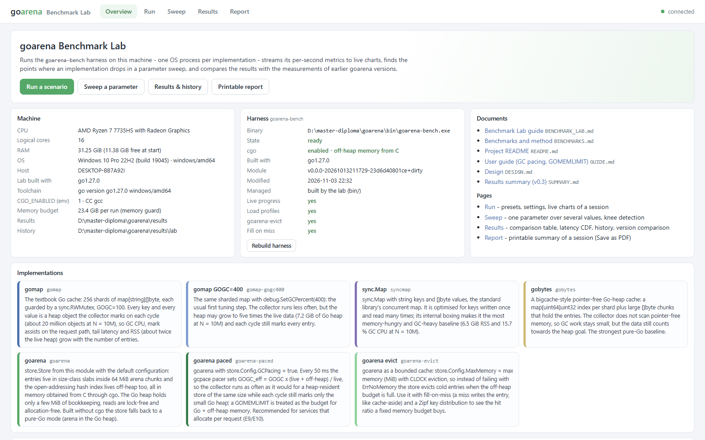
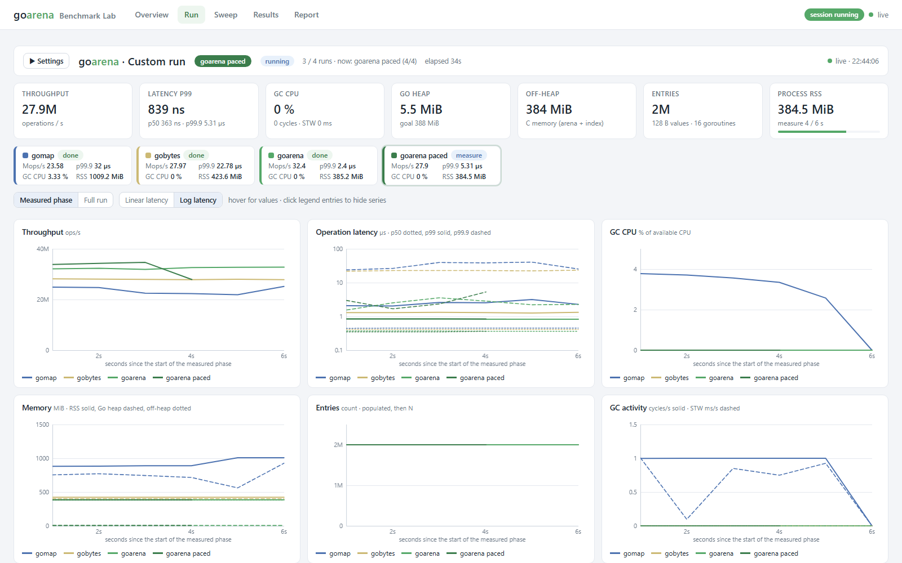
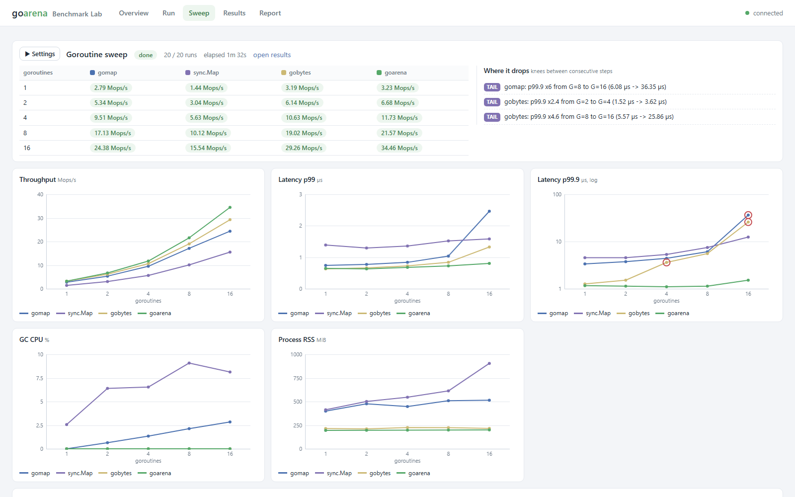
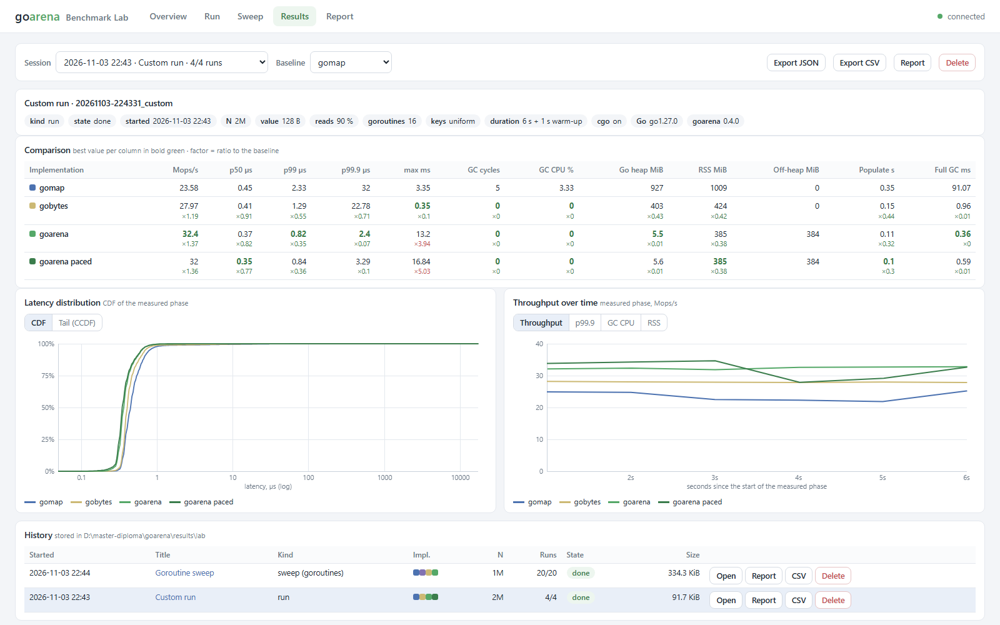

# goarena Benchmark Lab

The Benchmark Lab (`cmd/goarena-lab`) is a local web application around the
benchmark harness [`cmd/goarena-bench`](../cmd/goarena-bench). It runs
scenarios on your machine, shows the per-second metrics of every run as live
charts, sweeps one parameter to find where an implementation "drops", keeps a
history of sessions and compares the results with the measurements of earlier
goarena versions in `results/`.

* Every implementation runs as a **separate goarena-bench process**, one after
  the other, exactly as in the thesis measurements (no GC state leaks between
  runs).
* The UI is a single page embedded in the binary (`//go:embed`): no CDN, no
  external fonts or libraries, works fully offline. Charts are hand-written
  canvas code.
* Standard library only, like the rest of the module.



## Running it

```sh
go run ./cmd/goarena-lab            # serves http://127.0.0.1:8090
go run ./cmd/goarena-lab -open      # ... and opens the browser
make lab                            # the same via the Makefile target (if your Makefile has it)
```

At startup the lab looks for the repository root (the directory whose
`go.mod` declares `github.com/vladislavprovich/goarena`, walking up from the
working directory) and builds the harness into `bin/goarena-bench(.exe)` if
the binary is missing or older than the module's Go sources. The build uses
your environment: on Windows set `CGO_ENABLED=1` and put MinGW-w64 GCC on the
`PATH` first, otherwise goarena is measured in its pure-Go fallback mode (the
Overview page warns about this).

```powershell
$env:PATH = "C:\path\to\mingw64\bin;$env:PATH"; $env:CGO_ENABLED = "1"
go run ./cmd/goarena-lab -open
```

| flag | default | meaning |
|---|---|---|
| `-addr` | `127.0.0.1:8090` | listen address; non-loopback addresses are refused |
| `-allow-remote` | `false` | allow a non-loopback `-addr` (the lab starts processes - only on trusted networks) |
| `-repo` | auto-detected | repository root |
| `-bench` | `<repo>/bin/goarena-bench` | use this harness binary instead of building one |
| `-results` | `<repo>/results` | results directory (history in `<results>/lab`) |
| `-open` | `false` | open the default browser |

Ctrl+C shuts the lab down gracefully: a running session is cancelled, its
harness process is killed and the partial session is saved.

## Pages

### Overview

What every implementation is, the machine (CPU model, logical cores, RAM, OS,
Go version of the lab and of the toolchain, `CGO_ENABLED`), the state of the
harness binary (path, cgo mode read from its build settings, which optional
flags it supports, *Rebuild harness* button), links to the documentation and
a short guide to the charts.

### Run



1. Pick a **preset** or edit the settings: implementations, N, value size,
   read %, goroutines, key distribution (uniform / Zipf with exponent s),
   request garbage (rate and bytes), memory limit (`GOMEMLIMIT`, MiB), max
   memory of `goarena-evict` (MiB), fill-on-miss, duration, warm-up and load
   profile (steady, ramp, spike, in-process goroutine sweep).
2. The **memory guard** card shows the projected peak RSS of each run while
   you edit (see below).
3. **Start session** runs the selected implementations sequentially;
   **Cancel** kills the running process and skips the rest.

Starting a session folds the settings away (the *Settings* button brings
them back) and shows the live view, laid out like the
`examples/httpcache` dashboard:

* a header with the session, the **badge of the implementation that is
  running now** (in its colour), progress and a live indicator;
* seven KPI tiles for the current implementation: THROUGHPUT (operations / s),
  LATENCY P99 (p50 and p99.9 below), GC CPU (cycles, stop-the-world ms of the
  last interval), GO HEAP (heap goal), OFF-HEAP (C memory: arena + index),
  ENTRIES (populated during populate, then N; hit ratio when relevant) and
  PROCESS RSS (phase and progress bar);
* a strip with one chip per implementation of the session - queued, running
  or finished - with Mops/s, p99.9, GC CPU and RSS, so the implementations
  can be compared at a glance while the session runs;
* a 3 x 2 grid of live charts, every implementation overlaid in its colour:
  Throughput (ops/s), Operation latency (p50 dotted, p99 solid, p99.9
  dashed), GC CPU, Memory (RSS solid, Go heap dashed, off-heap dotted),
  Entries (or Hit ratio, switchable when the workload has misses) and GC
  activity (cycles/s solid, STW ms/s dashed, from the `stw_ms` field of the
  progress lines).

The log below shows every non-progress line the harness writes to stderr (the
summary line, errors). The final sub-interval of a few milliseconds that the
harness writes at the end of a phase is not plotted (its rates are noise).

### Deep links

The page reads parameters from the hash, so a demo script or a bookmark can
open a prepared view (nothing is ever started by a URL):

| URL | effect |
|---|---|
| `http://127.0.0.1:8090/#/run?preset=baseline-10m` | Run page with the preset filled in and highlighted |
| `http://127.0.0.1:8090/#/sweep?preset=goroutine-sweep` | Sweep page with the sweep preset filled in (a sweep preset given to `#/run` switches to `#/sweep`) |
| `#/run?live=1` | live view with the settings folded away (`&x=full` for the full-run time axis) |
| `#/results?id=<session id>`, `#/report?id=<session id>` | open a stored session |
| `...&snap=1` | replay the current session once instead of keeping the event stream open (for headless screenshots, e.g. `chrome --headless=new --screenshot --virtual-time-budget=6000 "http://127.0.0.1:8090/#/run?live=1&snap=1"`) |

Preset ids: `baseline-10m`, `large-20m`, `zipf-hot`, `write-heavy`,
`request-garbage`, `memory-budget`, `bounded-evict`, `load-ramp`, `spikes`,
`goroutine-sweep`, `value-size-sweep`.

### Sweep



Choose one parameter - goroutines, N, value size, read ratio (entered in %) or
garbage rate - and a list of values (`1, 2, 4, 8`, `1M, 5M, 10M`; `k`/`M`/`G`
suffixes are accepted), the implementations and the base settings. Every
(value x implementation) pair is a separate process, values in the outer loop.
The page plots throughput, p99, p99.9, GC CPU and RSS against the parameter
and lists **where it drops** (knees, see below) as it goes.

### Results



* **Comparison table** of the selected session: Mops/s, p50/p99/p99.9/max, GC
  cycles, GC CPU, Go heap, RSS, off-heap, populate time, the cost of one full
  GC after the run, and - when relevant - hit ratio and evictions. The best
  value of every column (within one sweep value) is bold green; the small
  factor under each value is its ratio to the **baseline** implementation
  chosen in the dropdown (green = better, red = worse).
* **Latency distribution** from the `latency_buckets` histogram of every run:
  CDF (log x axis) or tail view (CCDF, log-log).
* **Throughput over time** (or p99.9, GC CPU, RSS) of the measured phase.
* **Stages** table when the run used a load profile.
* **History**: every finished session, with open / report / CSV / delete.
* **Version comparison**: the historical result files are imported and the
  repeats of each configuration averaged; pick a scenario (E1 at 1M/5M/10M,
  E4 1 KiB / 4 KiB, E5 one goroutine, E6 Zipf and write-heavy, E9 at 5M and
  10M, E10) and a metric to see a table and a grouped bar chart of every
  implementation across v0.1 / v0.2 / v0.3 / v0.4 / demo ("-" = not measured).
  The Go version of each version's runs is shown in the first row.
* **Export** the selected session or the comparison as JSON or CSV.

### Report

A printable summary of the newest (or the selected) session: configuration,
machine, time-series or sweep charts, knees, comparison table, latency CDF and
CCDF, stages. **Print / Save as PDF** uses the browser's print dialog; the
print style sheet hides the navigation and keeps charts and tables on whole
pages.

## Presets

| preset | settings | implementations |
|---|---|---|
| Baseline 10M | N = 10M, 128 B, 90 % reads, G = 16, 10 s + 2 s warm-up | gomap, gomap-gogc400, syncmap, gobytes, goarena, goarena-paced |
| Large scale 20M | N = 20M | gomap, gobytes, goarena |
| Hot keys (Zipf) | N = 5M, Zipf s = 1.1 | all six |
| Write-heavy 50 % | N = 5M, 50 % reads | all six |
| Service with request garbage | N = 5M, garbage rate 1, 1024 B | gomap, syncmap, gobytes, goarena, goarena-paced |
| Container memory budget | as above + GOMEMLIMIT 1210 MiB | gomap, syncmap, gobytes, goarena, goarena-paced |
| Bounded cache with eviction | N = 10M, Zipf 1.1, fill-on-miss, max memory 512 MiB | goarena, goarena-evict |
| Load ramp | profile `ramp`, N = 5M, 16 s | all six |
| Write / garbage spikes | profile `spike`, N = 5M, 16 s | all six |
| Goroutine sweep (Sweep page) | G = 1, 2, 4, 8, 12, 16, N = 2M, 5 s | all six |
| Value-size sweep (Sweep page) | 64, 256, 1024, 4096 B, N = 1M | gomap, gobytes, goarena |

Presets only fill the form; review the settings and press Start.

## How to read the charts

* **x axis of the live charts**: seconds since the start of the *measured*
  phase of each run, so runs that executed one after another are overlaid
  (switch to *Full run* to include populate and warm-up; the x axis is then
  seconds since the process started).
* **Throughput**: million operations per second in each 1-second interval.
* **Latency**: p99 (solid) and p99.9 (dashed) per interval, in microseconds,
  of the sampled operations (every 16th operation is timed with the TSC
  clock). The log scale (default) keeps a heavy tail from flattening the
  others.
* **GC CPU**: share of the available CPU spent in the garbage collector.
  **GC cycles/s**: collections per second.
* **Memory**: per implementation, solid = process RSS, dashed = Go heap,
  dotted = off-heap (C) memory, in MiB. goarena keeps its data off-heap, so its
  Go heap stays near zero while RSS ~ off-heap.
* **Hit ratio** (shown with fill-on-miss or when there are misses): share of
  reads that found their key.
* **Markers**: vertical lines mark the stages of a load profile (red, labelled
  with the stage name, e.g. `g=8`, `write-spike`) and, in the full view, the
  phase boundaries.
* Hover any chart for the values of all series at that point; click a legend
  entry to hide or show a series.
* Colors: goarena green, goarena paced dark green, goarena evict light green
  (dashed), gomap blue, gomap GOGC=400 light blue, sync.Map purple, gobytes
  sand; red marks knees and warnings.

### Knees ("where it drops")

Knee detection runs on the server (`cmd/goarena-lab/knees.go`) after every
run of a sweep. For every implementation the points are sorted by the
parameter value and each consecutive pair of steps is checked:

| kind | rule |
|---|---|
| throughput drop | throughput falls by more than **15 %** versus the previous step |
| scaling loss | only for parameters where throughput should *rise* (goroutines): the step's scaling efficiency `(T_cur / T_prev) / (x_cur / x_prev)` (1.0 = linear) is below **half of the previous step's** efficiency (the first step is compared with the ideal 1.0); not reported again when the step is already a throughput drop |
| tail rise | p99.9 more than **doubles** |
| GC rise | GC CPU rises by more than **10 percentage points** |

Knees are drawn as red rings on the sweep charts and listed in words, e.g.
`gomap: throughput -23 % from N=5M to N=10M (25.4 -> 19.6 Mops/s)`. They are
stored in the session and returned by the API. Note that throughput naturally
falls with larger values (more bytes copied per operation), so a value-size
sweep usually shows drops at the large sizes for every implementation; compare
the implementations with each other there.

## Memory guard

Before a session starts, the lab projects the peak RSS of every run and
refuses the session (HTTP 400, the UI shows the estimate in red) if any run
exceeds the safe budget **min(75 % of physical RAM, RAM - 6 GiB)** (23.4 GiB
on a 32 GB machine; 8 GiB if the RAM size cannot be read). The projection,
in MiB, is

```
N x (fixed + perValueByte x valueSize) / MiB  x  garbageFactor (if garbage rate > 0)  +  50
```

| implementation | fixed B/entry | B per value byte | garbage factor |
|---|---|---|---|
| gomap | 266 | 1.98 | 1.5 |
| gomap-gogc400 | 140 | 5.0 | 3.4 |
| syncmap | 430 | 2.0 | 2.4 |
| gobytes | 96 | 1.01 | 2.05 |
| goarena | 73 | 1.06 | 1.05 |
| goarena-paced | 73 | 1.06 | 2.25 |
| goarena-evict | as goarena, data capped at max memory | | 1.05 |

With a memory limit the Go-heap implementations (and goarena-paced, whose
pacer treats GOMEMLIMIT as the total budget) are capped at
max(1.1 x the no-garbage estimate, 1.15 x the limit). The coefficients were
fitted from `results/SUMMARY.md` (E1, E4, E9) and rounded up; they live in one
table in `cmd/goarena-lab/estimate.go`.

## Where the history is stored

Every session that produced at least one result is written to
`results/lab/<yyyymmdd-hhmmss>_<preset-or-custom>.json` (sweeps:
`..._sweep-<param>.json` or the sweep preset id). The file contains the session
configuration, the machine, the harness binary and, per run, its command line,
state, summary, the full result document of the harness (including
`latency_buckets`) and the per-second timeline. Cancelled sessions keep the
runs that finished. Delete entries on the Results page or remove the files.

Historical results are read (never written) from `results/v1/raw` (v0.1),
`results/v2/raw` (v0.2), `results/raw` (v0.3),
`results/demo/baseline-v0.4/raw` (v0.4) and `results/demo/raw` ("demo").
Older files may lack fields such as `goarena_version`, `store` or `pacer`;
they are tolerated. Runs with catalogue labels outside a scenario's
experiments (e.g. E7 with gctrace at the E1 parameters) are excluded; runs
with custom labels are included when their parameters match.

## API

All endpoints speak JSON; POST bodies must be `Content-Type: application/json`.

| endpoint | purpose |
|---|---|
| `GET /api/info` | machine, toolchain, harness state, implementations, sweep parameters, budget, docs |
| `GET /api/presets` | the scenario presets |
| `POST /api/estimate` | `{"config": RunConfig}` or `{"sweep": SweepConfig}` -> memory-guard report (`valid:false` + error for invalid settings) |
| `POST /api/run` | start a run session with a `RunConfig`; 202, 400 (validation / memory guard with `estimate`), 409 (busy), 503 (harness not ready) |
| `POST /api/sweep` | start a sweep `{"base": RunConfig, "param": "...", "values": [...]}` |
| `POST /api/cancel` | cancel the running session -> `{"cancelled": bool}` |
| `POST /api/rebuild` | rebuild (or re-probe) the harness; 409 while a session runs |
| `GET /api/status` | busy flag, current or last session (without timelines), harness state |
| `GET /api/events` | Server-Sent Events: `session_started`, `run_started`, `progress`, `log`, `run_finished`, `knees`, `session_finished`, `bench`; a new connection is replayed the events of the current session, reconnects resume with `Last-Event-ID`; `?once=1` returns the replay and closes the stream |
| `GET /api/history` | stored sessions (+ the current unsaved one) |
| `GET /api/history/{id}` | one session (full) |
| `DELETE /api/history/{id}` | delete a stored session |
| `GET /api/historical[?reload=1]` | imported historical results: sources, averaged groups, scenarios |
| `GET /api/compare?scenario=e1-10m` | version comparison of one scenario (`scenario=custom&n=..&value=..&goroutines=..&dist=..&reads=..&garbage=..&memlimit=..` for ad-hoc filters) |
| `GET /api/export/{id}.json`, `/api/export/{id}.csv` | download a session |
| `GET /api/export/compare.json?scenario=..`, `.csv` | download a comparison |
| `GET /api/doc/{name}.md` | the repository documents linked from the Overview |

`RunConfig` fields: `impls` (whitelist: gomap, gomap-gogc400, syncmap,
gobytes, goarena, goarena-paced, goarena-evict), `n`, `value_size`,
`read_ratio` (0..1), `goroutines`, `dist` (`uniform` | `zipf`), `zipf_s`,
`garbage_rate`, `garbage_bytes`, `memlimit_mib`, `maxmem_mib`,
`fill_on_miss`, `duration_s`, `warmup_s`, `profile` (`steady` | `ramp` |
`spike` | `sweep-goroutines`), `preset`. Unknown fields and out-of-range
values are rejected; only validated values are passed to the harness.

The server accepts requests only for a loopback `Host` (against DNS
rebinding), refuses state-changing requests from a foreign `Origin` and
starts at most one session at a time.

## Harness contract

The lab runs

```
goarena-bench run -impl <impl> -n <N> -value <B> -goroutines <G> -reads <r> -dist uniform|zipf [-zipf-s <s>]
  -duration <d> -warmup <w> -garbage-rate <g> -garbage-bytes <b> [-memlimit <MiB>] [-maxmem <MiB>]
  [-fill-on-miss] [-profile ramp|spike|sweep-goroutines] [-progress] -exp lab[-<preset>] -out <file.json>
```

and probes the binary first (`run -h` for the flags, `list` for the
implementations): optional flags are passed only when needed, and only if
the binary supports them; `-progress` is passed when supported (without it
the charts fill only when a run ends). The child environment drops `GOGC`,
`GOMEMLIMIT`, `GODEBUG` and `GOMAXPROCS` so that the harness flags alone
define the GC setup. `-progress` lines on stderr
(`{"type":"progress","phase":...,"t_s":...,"ops_per_sec":...,"stw_ms":...}`) feed the
live charts; every other stderr line goes to the log. The final result is read
from `-out` (fields of `result_format.go`, plus the optional `options.profile`,
`options.maxmem_mib`, `options.fill_on_miss`, `write_errors`, `evictions`,
`stages` and `timeline`).

## Troubleshooting

* **"refusing to listen ... not a loopback address"** - use `-addr
  127.0.0.1:PORT`, or `-allow-remote` if you really want to expose it.
* **Harness state "error: go build failed"** - see the build log on the
  Overview page; fix the build (or pass `-bench` with a prebuilt binary) and
  press *Rebuild harness*.
* **cgo shows "disabled"** - the harness was built with `CGO_ENABLED=0`
  (no C compiler found). Set `CGO_ENABLED=1`, put GCC on the `PATH`, restart
  the lab or press *Rebuild harness*.
* **Charts stay empty until a run finishes** - the harness binary does not
  support `-progress`; rebuild it from a source tree that has the flag.
* **"needs flag -profile / -maxmem / -fill-on-miss" or "does not know
  implementation goarena-evict"** - the binary predates these features;
  rebuild it.
* **Memory guard refuses a run** - lower N or the value size, deselect the
  memory-hungry implementations (sync.Map, gomap GOGC=400), or set a memory
  limit.
* **409 "a session is already running"** - only one session runs at a time;
  cancel it or wait. Another browser tab joining sees the running session.
* **Port in use** - start with another `-addr`, e.g. `127.0.0.1:8091`.
* **Benchmark numbers look noisy** - close other applications, keep the
  laptop on mains power, and prefer longer durations; every run is a single
  repeat (use the history to compare repeats).
