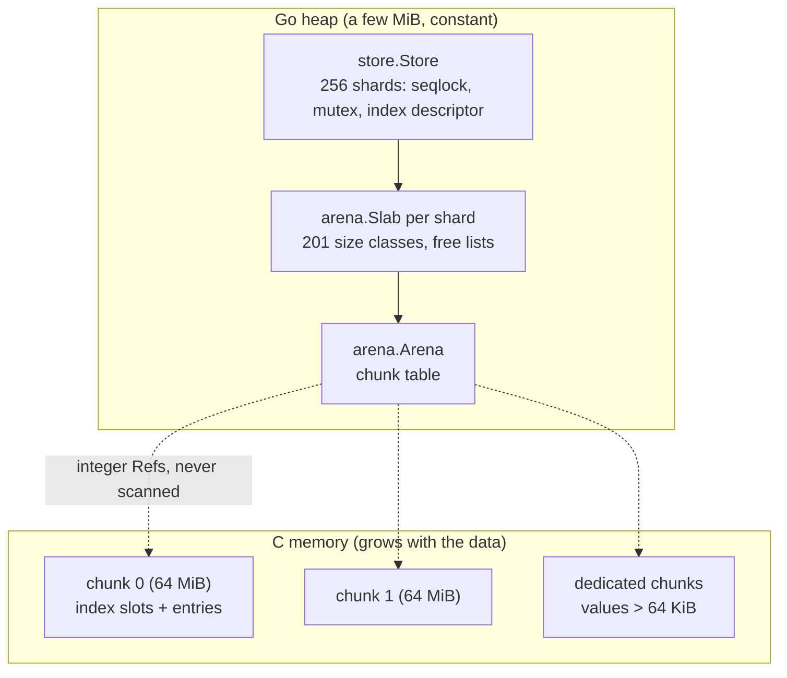

# goarena user guide

This guide explains how to use goarena in a real program: the concepts, every
configuration option, the read and write API, memory sizing, GC tuning,
observability, testing and migration from other caches. For the internals
see [DESIGN.md](DESIGN.md); for measurements see [BENCHMARKS.md](BENCHMARKS.md).

## Contents

- [Concepts](#concepts)
- [Creating and configuring a store](#creating-and-configuring-a-store)
- [Reading](#reading)
- [Writing, TTL and eviction](#writing-ttl-and-eviction)
- [Memory sizing](#memory-sizing)
- [GC pacing and GOMEMLIMIT](#gc-pacing-and-gomemlimit)
- [Observability](#observability)
- [Concurrency guarantees](#concurrency-guarantees)
- [Typed data with the arena package](#typed-data-with-the-arena-package)
- [Error handling](#error-handling)
- [Testing code that uses goarena](#testing-code-that-uses-goarena)
- [Migrating from other caches](#migrating-from-other-caches)
- [Production checklist](#production-checklist)

---

## Concepts

### Go heap and off-heap memory

The Go garbage collector traces every live object that contains pointers,
on every cycle. A cache of ten million `map[string][]byte` entries holds about
twenty million heap objects (keys and values) that the collector marks again
and again, and the heap goal (`live × (1 + GOGC/100)`) makes the process use
about twice the live data. GC CPU time, mark assists on the request path,
tail latency and memory all grow with the size of the cache.

goarena keeps such data **off-heap**, in memory obtained from the C allocator
through cgo. The collector neither scans that memory nor counts it towards the
heap goal or `GOMEMLIMIT`. A store with 10 million entries leaves about 4 MiB
in the Go heap ([BENCHMARKS.md](BENCHMARKS.md#results-at-n--10-million-entries)),
so a full GC cycle costs 0.45 ms instead of 316 ms for the equivalent map.

The price:

- **explicit lifetime** - the memory is freed by `Close`, not by the GC;
- **copy semantics** - values are copied in on `Set` and out on `Get`
  (or read in place, under a lock, with `View`);
- **bytes only** - keys and values are `[]byte` (or `string`); structured
  values must be serialized, because Go pointers must never be stored in
  memory the GC does not see.

### The three layers: arena, slab, store



| layer | type | what it does | thread safety |
|---|---|---|---|
| arena | `arena.Arena` | requests large chunks (64 MiB by default) from C and hands out 8-byte aligned pieces with a bump pointer; references are 64-bit integers (`arena.Ref`) | safe for concurrent use |
| slab | `arena.Slab` | frees and reuses individual blocks: 201 size classes with free lists, on top of an arena | not safe (one per shard in the store) |
| store | `store.Store` | sharded hash index plus entries, both in the arena; lock-free reads, TTLs, statistics | safe for concurrent use |

Most programs only use `store`. The `arena` package is for typed,
pointer-free data (see [Typed data with the arena package](#typed-data-with-the-arena-package)).

### Lifetime: explicit Close

A store owns its memory until `Close`:

```go
s, err := store.New(store.Config{})
if err != nil {
	return err
}
defer s.Close() // returns every byte to the C allocator
```

- `Close` is idempotent and always returns `nil`. It waits for in-flight
  operations (including lock-free readers) before it frees memory.
- After `Close`, writes return `store.ErrClosed` and reads report "not found".
- A store that becomes unreachable without `Close` is closed by a finalizer
  and counted in `store.FinalizedStores()`. That is a safety net for bugs,
  not a way to manage memory: the finalizer runs at an unpredictable time.
- Memory freed by `Delete`, overwrites and `EvictExpired` is reused by later
  writes of a similar size, but it is not returned to the operating system
  before `Close` (see the [FAQ](FAQ.md#why-does-memory-not-shrink-after-i-delete-entries)).

### Builds without cgo

goarena needs cgo for off-heap memory. When it is built with
`CGO_ENABLED=0` (no C compiler installed, cross-compilation, `scratch`
images), it falls back to a pure-Go allocator:

| | with cgo (`arena.OffHeap == true`) | without cgo (`arena.OffHeap == false`) |
|---|---|---|
| where the data lives | C memory | pointer-free `[]byte` blocks in the Go heap |
| scanned by the GC | no | no (pointer-free memory is never scanned) |
| counted by GOGC heap goal and `GOMEMLIMIT` | no | **yes** |
| visible in heap profiles | no | yes |
| `Stats.OffHeapBytes` | = `ArenaReservedBytes` | 0 |
| `Config.GCPacing` | adjusts GOGC/GOMEMLIMIT | no effect (not needed) |
| allocation failure | `ErrNoMemory` | the Go runtime aborts the process ("out of memory"); `MaxMemory` still works |

The API and its behaviour are otherwise identical, and every test passes in
both modes. Mark work stays small, but the heap-size and pacing benefits are
lost, so use cgo builds in production. Check the mode at start-up:

```go
if !arena.OffHeap {
	log.Print("goarena built without cgo: cache data is kept in the Go heap")
}
```

Installation of a C compiler is covered in the [README](../README.md#installation)
and [TROUBLESHOOTING.md](TROUBLESHOOTING.md#cgo-is-not-enabled).

---

## Creating and configuring a store

```go
s, err := store.New(store.Config{
	Shards:          256,              // default
	ChunkSize:       64 << 20,         // default: 64 MiB
	MaxMemory:       8 << 30,          // fail writes with ErrNoMemory above 8 GiB
	DefaultTTL:      30 * time.Minute, // every Set expires after 30 minutes
	InitialCapacity: 10_000_000,       // pre-size the index for 10M entries
	GCPacing:        true,             // recommended for services
})
```

The zero `Config{}` is valid and a good start. `store.MustNew(cfg)` panics
instead of returning an error; use it in tests, examples and package-level
variables with a constant configuration.

### Config reference

| field | default (zero value) | valid range | effect |
|---|---|---|---|
| `Shards` | 256 (`store.DefaultShards`) | 1 - 65 536, rounded up to a power of two | number of independently locked partitions |
| `ChunkSize` | 64 MiB (`arena.DefaultChunkSize`) | 4 KiB - 2 GiB, rounded up to 4 KiB | size of every block requested from the C allocator |
| `MaxMemory` | 0 = unlimited | >= 0 | limit of all reserved memory (entries, index, large values); writes beyond it return `ErrNoMemory` |
| `DefaultTTL` | 0 = no expiry | >= 0 | time to live applied by `Set`, `SetString`, `GetOrSet` and `GetOrLoad` |
| `InitialCapacity` | 0 = minimum index | >= 0 | number of entries the index is pre-sized for |
| `GCPacing` | false | | registers the store with the GC pacer (package `gcpace`) |

`New` returns an error for negative values, a shard count above 65 536 and a
chunk size outside the valid range.

### Choosing the values

**Shards.** Reads take no lock, so shards matter mainly for writes: writers of
the same shard serialize on its mutex, writers of different shards run in
parallel. Each shard has a fixed cost: about 8 KiB of Go heap for its size
class state (about 2 MiB for 256 shards, [DESIGN.md, 5.1](DESIGN.md#51-size-classes-log-linear-table-v030)),
1 KiB of initial index and, once it holds data, at least one 64 KiB span of
off-heap memory. Guidance:

- default 256 for large stores and many cores;
- 16 - 64 for small stores (up to some hundred thousand entries) or many
  stores per process;
- more (512 - 1024) only if profiles show writers waiting on shard locks
  with a write-heavy workload on many cores.

**ChunkSize.** Memory is reserved from C one chunk at a time, so this is the
granularity of growth and of `MaxMemory`. Larger chunks mean fewer cgo calls:
populating 10 million entries with 64 MiB chunks performs 28 cgo calls in
total ([BENCHMARKS.md](BENCHMARKS.md#micro-benchmarks-go-test--bench-5-runs)).
An empty default store already reserves one 64 MiB chunk, because the
initial index lives in the arena. For small stores and tests use 1 - 4 MiB.
Values larger than a chunk get a dedicated chunk of their own.

**MaxMemory.** Set it whenever the process has a memory budget. Because
memory is reserved in chunks, the effective limit is the largest multiple of
`ChunkSize` that fits (plus dedicated chunks for large values): with 64 MiB
chunks a 100 MiB limit allows one regular chunk. Choose `MaxMemory` as a
multiple of `ChunkSize`, or lower `ChunkSize` for small limits. See
[MaxMemory and ErrNoMemory](#maxmemory-and-errnomemory).

**DefaultTTL.** Use it when every entry should expire (sessions, rate-limit
windows). `SetWithTTL` overrides it per entry; `SetWithTTL(k, v, 0)` stores an
entry that never expires. Entries with a TTL carry a 16-byte header instead of
8 bytes. Expired entries are invisible at once but are only freed by
[`EvictExpired`](#periodic-eviction).

**InitialCapacity.** Pre-sizes every shard's index so that this many entries
fit without rehashing. A rehash rebuilds one shard's index under its writer
lock; pre-sizing avoids these pauses during a bulk load, at the price of
reserving the index up front (10 million entries: 256 MiB of index, reserved
by `New`). Leave it at 0 when the final size is unknown; the index then
doubles as needed and outgrown tables are recycled as entry memory.

**GCPacing.** Turn it on for services that allocate per request; see
[GC pacing and GOMEMLIMIT](#gc-pacing-and-gomemlimit).

---

## Reading

| method | returns | allocations per hit | lock | rules |
|---|---|---|---|---|
| `Get(key)` | a fresh copy | 1 (none for an empty value) | none | always safe |
| `GetString(key)` | a string copy | 1 | none | always safe |
| `GetInto(dst, key)` | value appended to `dst[:0]` | 0 when `cap(dst)` is large enough | none | result shares `dst`'s array |
| `View(key, fn)` | `fn` called with a zero-copy view | 0 | shard lock while `fn` runs | `fn` must not retain or modify the slice, nor call the store |
| `Has(key)`, `HasString(key)` | presence | 0 | none | |
| `Range(fn)` | `fn` called for every entry | 0 | one shard lock at a time | as for `View` |

"No lock" means the read path is a seqlock read: the reader copies the value
and validates it against the shard's sequence number; it retries if a writer
interfered and falls back to the shard lock after four failed attempts.
Readers never write to shared memory, so many goroutines can read the same
hot key without contention: 48.66 Mops/s with a Zipf (s = 1.1) key
distribution versus 22.12 for `sync.Map`
([BENCHMARKS.md](BENCHMARKS.md#skewed-and-write-heavy-workloads-n--5-m)).

Choose:

- **`GetInto`** on hot paths: keep one buffer per goroutine or request and
  reuse it.

  ```go
  buf := make([]byte, 0, 4096)
  for req := range requests {
  	var ok bool
  	buf, ok = s.GetInto(buf, req.Key) // no allocation once buf is large enough
  	if ok {
  		req.Reply(buf)
  	}
  }
  ```

- **`Get`** / **`GetString`** when the value must outlive the call and
  simplicity matters more than one allocation.
- **`View`** to parse or hash a large value in place without copying it. The
  shard's writers wait while `fn` runs, so keep it short. Copy anything you
  need afterwards:

  ```go
  var size uint32
  found := s.View(key, func(v []byte) {
  	size = binary.BigEndian.Uint32(v[:4]) // read in place, keep only a number
  })
  ```

- **`Has`** for membership tests (deduplication, allow lists).

Every read reports "not found" for absent keys, for expired entries and after
`Close`.

---

## Writing, TTL and eviction

| method | effect |
|---|---|
| `Set(key, val)`, `SetString` | store or replace; `DefaultTTL` applies |
| `SetWithTTL(key, val, ttl)`, `SetStringWithTTL` | store or replace with a TTL (`ttl <= 0`: never expires) |
| `GetOrSet(key, val)` | return the present value, or store `val` if the key is absent or expired (atomic) |
| `GetOrLoad(key, load)` | cache-aside: return the present value, or call `load`, store and return its result |
| `Delete(key)`, `DeleteString` | remove; reports whether a live entry was removed |
| `EvictExpired()` | free all expired entries; returns their number |

Keys and values are copied: the caller may reuse the slices immediately.
Overwriting a value with one of the same size class happens in place without
allocation; otherwise a new block is allocated and the old one goes to a free
list. A failed write (for example `ErrNoMemory`) leaves the previous value
intact.

Limits: keys up to 65 535 bytes (`store.MaxKeySize`), entries up to 1 GiB
(`store.MaxEntrySize`, header + key + value). Larger writes return
`ErrTooLarge`.

### Periodic eviction

Expired entries are invisible to readers immediately, but their memory is
only freed by `EvictExpired`, which sweeps every shard (each under its writer
lock, one at a time). There is no background goroutine; run one yourself:

```go
// evictLoop frees expired entries every interval until ctx is done.
func evictLoop(ctx context.Context, s *store.Store, interval time.Duration) {
	t := time.NewTicker(interval)
	defer t.Stop()
	for {
		select {
		case <-ctx.Done():
			return
		case <-t.C:
			if n := s.EvictExpired(); n > 0 {
				log.Printf("cache: evicted %d expired entries", n)
			}
		}
	}
}
```

Pick an interval of a fraction of the TTL (for example a minute for 30-minute
sessions). `Len` and `Stats().Entries` include expired entries that were not
evicted yet.

### Cache-aside with GetOrLoad

```go
func (r *UserRepo) Get(ctx context.Context, id string) ([]byte, error) {
	return r.cache.GetOrLoad([]byte("user:"+id), func() ([]byte, error) {
		u, err := r.db.LoadUser(ctx, id) // runs without any store lock held
		if err != nil {
			return nil, err // nothing is cached
		}
		return json.Marshal(u)
	})
}
```

Semantics:

- a hit is a lock-free read, like `Get`;
- on a miss `load` is called **outside of any lock**, so it may be slow and
  may use the store;
- if `load` fails, nothing is stored and its error is returned unchanged;
- the result is stored with `GetOrSet` semantics (with `DefaultTTL`): **the
  first value stored wins**;
- concurrent misses of the same key are **not deduplicated**: several
  goroutines may call `load`, but all of them return the value that was
  stored first. If duplicate loads are expensive, wrap the call in a
  single-flight group (for example `golang.org/x/sync/singleflight`);
- if the loaded value cannot be stored (`ErrTooLarge`, `ErrNoMemory`), the
  loaded value is returned **together with** the error, so the caller can still
  serve it;
- after `Close` it returns `ErrClosed` without calling `load`.

`GetOrSet(key, val)` is the atomic building block: of several goroutines
calling it for the same absent key, exactly one stores its value and the
others get that value back with `loaded == true`.

### Deleting

`Delete` frees the entry's block for reuse and reports whether a live entry
was removed (`false` for absent or already expired keys). Deleted index slots
become tombstones that are purged when the shard's index is rebuilt.

### Iterating

```go
s.Range(func(key, val []byte) bool {
	fmt.Printf("%s = %d bytes\n", key, len(val))
	return true // return false to stop
})
```

`Range` visits shards one at a time and holds each shard's lock while its
entries are visited: it sees a consistent view of one shard, not a snapshot of
the whole store, and there is no defined order. The slices alias off-heap
memory; copy what you keep and do not call the store from the callback.

---

## Memory sizing

### Bytes per entry

Every entry costs its slab block plus its share of the index
([DESIGN.md, 7.3 and 7.4](DESIGN.md#73-index-open-addressing-with-linear-probing)):

```
bytes per entry ≈ class(header + len(key) + len(value)) + 16 / load factor

header       = 8 bytes (16 bytes for entries with a TTL)
class(n)     = n rounded up to the next size class:
               8-byte steps up to 256 B,
               32 classes per power of two from 256 B to 8 KiB (waste < 3.1 %),
               ×1.25 steps from 8 KiB to 64 KiB (waste up to ~20 %),
               above 64 KiB: ×1.25 steps rounded to 4 KiB (waste up to 25 %)
index slot   = 16 bytes; the load factor lies between 0.375 and 0.75,
               i.e. 21 - 43 bytes per entry (about 27 B at load factor 0.6)
```

`arena.ClassSize(n)` returns the class of a size. Examples:

| key + value | entry (no TTL) | block | waste |
|---|---|---|---|
| 20 B + 64 B | 92 B | 96 B | 4.2 % |
| 20 B + 128 B | 156 B | 160 B | 2.5 % |
| 20 B + 256 B | 284 B | 288 B | 1.4 % |
| 20 B + 1 KiB | 1052 B | 1056 B | 0.4 % |
| 20 B + 4 KiB | 4124 B | 4224 B | 2.4 % |

On top of that come a constant Go-heap overhead of about 2 - 4 MiB per store
with 256 shards, chunk granularity (the last chunk is partly empty) and the
free lists left behind by deletes and size changes (`Stats.FreeListBytes`).

### Worked example: 10 million entries

10 million entries with 20-byte keys and 128-byte values, no TTL:

```
entry      8 + 20 + 128           = 156 B  -> 160 B block
index      16 B / 0.6 load factor ≈  27 B
total      ≈ 187 B per entry
10 M ×187 B ≈ 1.87 GB ≈ 1.74 GiB
```

The benchmark with exactly this data set measured a process RSS of 1797 MiB
(1.75 GiB) and a Go heap of 4 MiB; a `map[string][]byte` with the same data
needed 4050 MiB RSS and a pointer-free Go-heap cache (bigcache-style) 1912 MiB
([BENCHMARKS.md](BENCHMARKS.md#results-at-n--10-million-entries)).

### MaxMemory and ErrNoMemory

`Config.MaxMemory` limits all memory the store reserves from C: entry
chunks, index tables and dedicated chunks of large values. When a write
needs more, it fails with an error that wraps `store.ErrNoMemory` and the
previous value of the key is kept:

```go
if err := s.Set(key, val); errors.Is(err, store.ErrNoMemory) {
	// err.Error() names the sizes and the limit, for example:
	// store: out of off-heap memory: cannot store a 20-byte key with a
	// 128-byte value: 134217728 of 134217728 bytes (Config.MaxMemory)
	// reserved in chunks of 67108864 bytes; delete entries, call
	// EvictExpired, raise MaxMemory or lower ChunkSize
	metrics.CacheFull.Inc()
	return serveWithoutCaching(val)
}
```

goarena has no eviction policy besides TTL: a full store does not drop old
entries by itself. Options when it is full: call `EvictExpired`, delete keys
you know are cold, or treat the cache as best-effort and skip caching. If you
need LRU/LFU eviction, see [USE_CASES.md](USE_CASES.md#you-need-an-eviction-policy-lru-lfu).

Without a `MaxMemory` limit, `ErrNoMemory` means the C allocator itself
failed (rare on systems that overcommit memory; the operating system's OOM
killer usually acts first). In builds without cgo the Go runtime aborts the
process instead; `MaxMemory` still works there.

---

## GC pacing and GOMEMLIMIT

Moving the data off-heap makes the live Go heap tiny, and with the default
`GOGC=100` the GC starts a cycle whenever the heap grows by its live size. A
service that allocates per request (decoding, buffers, responses) then runs
hundreds of GC cycles per second: each is cheap, but together they cost
throughput. In the benchmark with a 1 KiB allocation per operation goarena
with default settings ran 306 GC cycles per second at 5.03 Mops/s
([BENCHMARKS.md](BENCHMARKS.md#service-that-allocates-per-request)).

`Config.GCPacing` fixes this:

```go
s, err := store.New(store.Config{GCPacing: true})
```

The pacer (package `gcpace`) periodically (every 50 ms) sets the GC percent so
that the heap goal is the one the runtime would use if the off-heap bytes were
part of the heap:

```
goal = live + (live + offHeap) × GOGC/100
```

The GC then runs about as often as for a heap-resident cache of the same
size, while every cycle still marks only the small Go heap. In the same
benchmark `GCPacing` reached 10.05 Mops/s at 11.3 GC cycles per second (p99.9
66 µs versus 384 µs). The price is the garbage headroom a heap-resident cache
would also use: RSS 2017 MiB instead of 946 MiB.

Details:

- the pacer is process-wide and reference-counted: all paced stores share one,
  and the previous `GOGC` and `GOMEMLIMIT` are restored when the last paced
  store is closed;
- it uses the `GOGC` in effect when it starts as its target (if `GOGC=off`,
  it leaves the GC percent alone and only manages the memory limit);
- batch jobs and programs that allocate little do not need it;
- in builds without cgo it has no effect (the data is in the Go heap already);
- `gcpace.SetDefaultConfig` changes the target `GOGC`, the total budget, the
  interval or the minimum Go limit before the first paced store is created.

### GOMEMLIMIT and memory budgets

`GOMEMLIMIT` counts only memory managed by the Go runtime, so it does not see
goarena's C memory. With `GCPacing`, a `GOMEMLIMIT` that is in effect when the
pacer starts is interpreted as the budget for **Go plus off-heap** memory: the
pacer sets the Go limit to `budget - offHeap` (at least 64 MiB) and updates
it as the store grows.

Without `GCPacing` you can do the same by hand with
`Store.GoMemoryBudget(total)`, which returns `total - OffHeapBytes`:

```go
debug.SetGCPercent(-1) // the limit alone triggers the GC
debug.SetMemoryLimit(s.GoMemoryBudget(budget))
// call it again whenever the store has grown significantly
```

### Containers and Kubernetes

Recommended configuration for a cache-heavy service in a container with a
memory limit `L`:

1. `GOMEMLIMIT` of about 90 % of `L` (the rest is headroom for thread stacks,
   C libraries and the kernel);
2. `MaxMemory` well below that, for example 60 - 70 % of `L`, so that the Go
   heap keeps room for request garbage (the pacer never lowers the Go limit
   below 64 MiB);
3. `GCPacing: true`.

```yaml
# Pod spec: pass the container limit to the program.
resources:
  limits:
    memory: 4Gi
env:
  - name: MEMORY_LIMIT_BYTES
    valueFrom:
      resourceFieldRef:
        resource: limits.memory
```

```go
func newCache() (*store.Store, error) {
	limit, _ := strconv.ParseInt(os.Getenv("MEMORY_LIMIT_BYTES"), 10, 64)
	if limit <= 0 {
		return store.New(store.Config{GCPacing: true}) // no budget known
	}
	debug.SetMemoryLimit(limit * 9 / 10) // the pacer reads it as the total budget
	return store.New(store.Config{
		MaxMemory: limit * 6 / 10 / (64 << 20) * (64 << 20), // whole 64 MiB chunks
		GCPacing:  true,
	})
}
```

Set the limit before the first paced store is created: the pacer captures
`GOMEMLIMIT` when it starts (alternatively pass the budget explicitly with
`gcpace.SetDefaultConfig(gcpace.Config{MemoryLimit: budget})`). In the
container-budget benchmark (`GOMEMLIMIT = 1210 MiB` for every implementation)
goarena with `GCPacing` reached 9.17 Mops/s at 1132 MiB RSS, while `map` and
`sync.Map` spent 55 - 74 % of the CPU time in the GC
([BENCHMARKS.md](BENCHMARKS.md#service-that-allocates-per-request)).

---

## Observability

### Stats fields

`Store.Stats()` returns a snapshot (shards are visited one at a time, so it
is not atomic across shards). It scans every index slot to compute probe
distances and locks each shard while doing so: call it at scrape intervals,
not per request. `Stats.String()` gives a one-line summary for logs:

```
1000 entries, 105.5 KiB of keys and values, 1.0 MiB reserved off-heap (index 32.0 KiB, load factor 0.49), 3.3% size-class waste; 1000 sets, 0 deletes, 0 expired
```

| field | meaning | use |
|---|---|---|
| `Shards` | number of shards | |
| `Entries` | entries in the index, including expired ones not yet evicted | size |
| `KeyValueBytes` | sum of `len(key) + len(value)` | payload size |
| `EntryBytes` | `KeyValueBytes` plus entry headers (8 B, 16 B with TTL) | |
| `SlabInUseBytes` | class-rounded bytes of live entries | |
| `FreeListBytes` | freed blocks waiting for reuse | growth here = churn between size classes |
| `SpanWasteBytes` | abandoned span tails | |
| `LargeObjects` | entries above the largest size class (64 KiB) | |
| `InternalFragmentation` | `1 - EntryBytes / SlabInUseBytes` | size-class waste |
| `ArenaReservedBytes` | all memory reserved by the arena (entries + index) | **the store's footprint** |
| `ArenaChunks`, `ArenaChunkMallocs` | live regular chunks, chunks requested over the lifetime | |
| `DonatedBytes` | outgrown index tables recycled as entry memory | |
| `IndexSlots`, `IndexBytes` | index size (`IndexBytes = IndexSlots × 16`) | |
| `Tombstones` | deleted slots not yet purged | |
| `LoadFactor` | `(Entries + Tombstones) / IndexSlots`, at most 0.75 | |
| `AvgProbeDistance`, `MaxProbeDistance` | displacement of entries from their home slot | hash quality |
| `OffHeapBytes` | C memory of the store (= `ArenaReservedBytes`; 0 without cgo) | compare with RSS |
| `Sets`, `Deletes`, `Expired` | counters since creation | rates |
| `CgoCalls` | process-wide cgo calls made by goarena | amortisation check |

### GC metrics with gcstats

Package `gcstats` reads the runtime's view (`runtime/metrics`, `MemStats`)
and the operating system's (RSS on Linux and Windows; zero on other systems):

```go
before := gcstats.Read()
runWorkload()
d := gcstats.Between(before, gcstats.Read())
fmt.Printf("GC: %d cycles, %.2f%% CPU, max pause %v, assists %.3fs\n",
	d.GCCycles, 100*d.GCCPUFraction, d.CyclePauseMax, d.AssistCPUSeconds)

g := gcstats.Read().Gauges() // JSON-friendly instantaneous values
fmt.Println(g.HeapLiveBytes, g.HeapGoalBytes, g.RSSBytes)
```

`gcstats.Read` calls `runtime.ReadMemStats`, which stops the world for a few
microseconds: call it at most a few times per second.

### Exporting metrics

With `expvar` (standard library), the statistics appear as JSON under
`/debug/vars`:

```go
expvar.Publish("cache", expvar.Func(func() any { return s.Stats() }))
```

A minimal handler in the Prometheus text exposition format, without extra
dependencies:

```go
func metricsHandler(s *store.Store) http.HandlerFunc {
	return func(w http.ResponseWriter, _ *http.Request) {
		st := s.Stats()
		g := gcstats.Read()
		w.Header().Set("Content-Type", "text/plain; version=0.0.4")
		metric := func(name, typ string, v float64) {
			fmt.Fprintf(w, "# TYPE %s %s\n%s %g\n", name, typ, name, v)
		}
		metric("goarena_entries", "gauge", float64(st.Entries))
		metric("goarena_key_value_bytes", "gauge", float64(st.KeyValueBytes))
		metric("goarena_reserved_bytes", "gauge", float64(st.ArenaReservedBytes))
		metric("goarena_offheap_bytes", "gauge", float64(st.OffHeapBytes))
		metric("goarena_free_list_bytes", "gauge", float64(st.FreeListBytes))
		metric("goarena_index_load_factor", "gauge", st.LoadFactor)
		metric("goarena_sets_total", "counter", float64(st.Sets))
		metric("goarena_deletes_total", "counter", float64(st.Deletes))
		metric("goarena_expired_total", "counter", float64(st.Expired))
		metric("goarena_finalized_stores_total", "counter", float64(store.FinalizedStores()))
		metric("process_gc_cycles_total", "counter", float64(g.GCCycles))
		metric("process_heap_live_bytes", "gauge", float64(g.HeapLiveBytes))
		metric("process_rss_bytes", "gauge", float64(g.Process.RSSBytes))
	}
}
```

If you already use the Prometheus client library, register the same values
with `prometheus.NewGaugeFunc` / `NewCounterFunc`. Hit and miss rates are best
counted in your own code around `Get`, because only the caller knows what a
miss means.

[examples/httpcache](../examples/httpcache) is a complete service with a
`/stats` endpoint and a live dashboard.

---

## Concurrency guarantees

- All `Store` methods are safe for concurrent use by any number of
  goroutines. You do not need a mutex around the store.
- Every operation on a single key is atomic: a read returns either the old or
  the new value of a concurrent write, never a mix (every lock-free read is
  validated against the shard's sequence number).
- Once `Set` has returned, every read that starts afterwards sees the new
  value (or a later one).
- Writes of the same shard serialize on the shard's mutex; writes to
  different shards run in parallel. Reads never block writes, and writes
  delay readers only for their short critical section.
- `GetOrSet` is atomic per key; `GetOrLoad` calls `load` without a lock and
  may call it more than once for concurrent misses (first stored value wins).
- `Range`, `Len`, `Stats` and `EvictExpired` visit shards one at a time; they
  are not snapshots of the whole store.
- `View` and `Range` callbacks run under a shard lock: they must not call
  methods of the same store (that may deadlock) and must not retain the
  slices.
- `Close` waits for in-flight operations. Operations that race with `Close`
  either complete normally or behave as after `Close`. Slices obtained from
  `View`/`Range` must not be used after `Close`.
- `arena.Arena` is safe for concurrent use; `arena.Slab` is not; `Arena.Reset`
  and `Arena.Release` must not run while other goroutines still use
  references into the arena.

---

## Typed data with the arena package

The `arena` package places Go values of pointer-free types in off-heap
memory: numbers, booleans, fixed-size arrays and structs of those. Strings,
slices, maps, interfaces, pointers and channels are refused, because the GC
does not see off-heap memory and could free what they point to.

```go
type sample struct {
	At    int64
	Value float64
	Tag   [8]byte // a fixed-size array instead of a string
}

a, err := arena.New(arena.Config{ChunkSize: 16 << 20})
if err != nil {
	return err
}
defer a.Release() // every value below dies with the arena

xs, err := arena.NewSlice[sample](a, 1_000_000) // 24 MB, zeroed, invisible to the GC
if err != nil {
	return err
}
xs[0].Value = 1.5

p := arena.MustNewValue[sample](a) // a single value
p.At = time.Now().UnixNano()

_, err = arena.NewSlice[string](a, 1) // arena.ErrPointerType: strings hold pointers
fmt.Println(arena.IsPointerFree[sample](), err)
```

Rules:

- values live until `Reset` (drops all allocations, keeps the chunks) or
  `Release` (returns the chunks to C); pointers into the arena must not be
  used afterwards;
- `append` beyond the length of an arena slice reallocates it in the Go heap,
  as for any slice;
- an `Arena` never frees individual allocations. For blocks that come and go,
  put a `Slab` on top: it rounds requests to one of 201 size classes and reuses
  freed blocks. A `Slab` is not safe for concurrent use - guard it with a
  mutex - and `Free` needs the size that was passed to `Alloc`:

  ```go
  sl := arena.NewSlab(a, arena.SlabConfig{})
  ref, err := sl.Alloc(100)       // a 104-byte block
  copy(sl.Bytes(ref, 100), payload)
  sl.Free(ref, 100)
  ```

- `arena.Ref` is a plain 64-bit integer: you can keep it in maps of integers,
  in other arena memory or in pointer-free structs; `Arena.Bytes(ref, n)` turns
  it back into a temporary `[]byte` view.

[examples/typed-arena](../examples/typed-arena) shows all of it.

---

## Error handling

Write errors wrap sentinel errors with details (sizes, limits). Always compare
with `errors.Is`, not `==`:

| error | returned by | cause | what to do |
|---|---|---|---|
| `store.ErrClosed` | writes, `GetOrSet`, `GetOrLoad` after `Close` | the store was closed | shutdown ordering: close the store after the users are stopped |
| `store.ErrTooLarge` | writes | key longer than 65 535 bytes or entry above 1 GiB | reject the request, or split the value |
| `store.ErrNoMemory` | writes, `New` | `MaxMemory` reached, or the C allocator failed | `EvictExpired`, delete cold keys, skip caching, alert; the old value is kept |
| error from `load` | `GetOrLoad` | your loader failed | returned unchanged; nothing is cached |
| `New` errors | `New` | negative values, more than 65 536 shards, chunk size outside 4 KiB - 2 GiB | fix the configuration |
| `arena.ErrPointerType` | `NewValue`, `NewSlice` | the type contains Go pointers | use fixed-size arrays and numbers |
| `arena.ErrOutOfMemory`, `ErrReleased`, `ErrInvalidSize` | `Arena`, `Slab` | limit reached / used after `Release` / bad size | |

Reads have no error result: absent, expired and closed all mean "not found".

Panics indicate programming errors: an invalid `arena.Ref`, `Slab.Free` with
a wrong size, `FreeDedicated` of something that is not a dedicated chunk,
`MustNew` with an invalid configuration.

---

## Testing code that uses goarena

Close every store the test creates; small chunks and few shards keep tests
fast and light:

```go
func newTestCache(t testing.TB) *store.Store {
	t.Helper()
	s := store.MustNew(store.Config{Shards: 4, ChunkSize: 1 << 20})
	t.Cleanup(func() { _ = s.Close() })
	return s
}
```

Detect stores that tests forget to close with `FinalizedStores`:

```go
func TestMain(m *testing.M) {
	code := m.Run()
	// Give the finalizers of unreachable stores a chance to run.
	for i := 0; i < 3; i++ {
		runtime.GC()
		time.Sleep(10 * time.Millisecond)
	}
	if n := store.FinalizedStores(); n > 0 && code == 0 {
		fmt.Fprintf(os.Stderr, "%d goarena store(s) were not closed\n", n)
		code = 1
	}
	os.Exit(code)
}
```

The check is best-effort (a finalizer runs only after the GC found the store
unreachable), but it reliably catches stores created in a loop or per test
without `Close`.

Further tips:

- TTL tests need real time: use short TTLs (milliseconds) and sleep a little
  longer than the TTL, as `ExampleStore_EvictExpired` does.
- `go test -race` works with cgo (see
  [TROUBLESHOOTING.md](TROUBLESHOOTING.md#race-detector-and-cgo)).
- If CI runs without a C compiler, the tests run in the pure-Go mode; checks of
  `OffHeapBytes` or of the Go heap size should depend on `arena.OffHeap`.

---

## Migrating from other caches

### From `map[string][]byte` with a mutex

| before | after |
|---|---|
| `mu.Lock(); m[k] = v; mu.Unlock()` | `s.SetString(k, string(v))` or `s.Set([]byte(k), v)` (no mutex needed) |
| `mu.RLock(); v, ok := m[k]; mu.RUnlock()` | `v, ok := s.Get(key)`, or `buf, ok = s.GetInto(buf, key)` on hot paths |
| `delete(m, k)` | `s.Delete(key)` |
| `len(m)` | `s.Len()` |
| `for k, v := range m` | `s.Range(func(k, v []byte) bool { ...; return true })` |
| map values of type `*T` or structs | serialize (JSON, protobuf, `encoding/binary`) to `[]byte` |
| the map is garbage-collected | `defer s.Close()` |

A stored map value can be modified by every holder of the slice; goarena
values are copies - write them back with `Set` after changing them.

### From `sync.Map`

| `sync.Map` | goarena |
|---|---|
| `Load(k)` | `Get(key)` |
| `Store(k, v)` | `Set(key, val)` |
| `LoadOrStore(k, v)` | `GetOrSet(key, val)` - same semantics (returns the present value and `loaded`) |
| `Delete(k)` | `Delete(key)` |
| `LoadAndDelete(k)` | `Get` + `Delete` (not atomic) |
| `Range(f)` | `Range(f)` |
| `CompareAndSwap`, `Swap` | no equivalent |

### From bigcache or freecache

Both keep entries in large pointer-free `[]byte` chunks inside the Go heap; the
`gobytes` baseline of the benchmarks implements the same technique.

| bigcache (v3) | freecache | goarena |
|---|---|---|
| `bigcache.New(ctx, cfg)` | `freecache.NewCache(size)` | `store.New(store.Config{...})` |
| `Set(key string, entry []byte) error` | `Set(key, value []byte, expireSeconds int) error` | `Set(key, val)` / `SetString(key, val)` / `SetWithTTL(key, val, ttl)` |
| `Get(key string) ([]byte, error)`, `ErrEntryNotFound` | `Get(key) ([]byte, error)`, `ErrNotFound` | `Get(key) ([]byte, bool)` |
| | `GetWithBuf(key, buf)` | `GetInto(buf, key)` |
| `Delete(key) error` | `Del(key) bool` | `Delete(key) bool` / `DeleteString(key) bool` |
| `Len()` | `EntryCount()` | `Len()` |
| `Config.LifeWindow` | `expireSeconds` per entry | `Config.DefaultTTL` / `SetWithTTL` |
| `Config.CleanWindow` | (lazy) | a ticker calling `EvictExpired` ([example](#periodic-eviction)) |
| `Config.HardMaxCacheSize` (MB) | `size` (bytes) | `Config.MaxMemory` (bytes) |
| `Config.Shards` | (fixed 256 segments) | `Config.Shards` |
| `Iterator()` | `NewIterator()` | `Range(fn)` |
| `Close()` (stops the cleaner) | - | `Close()` (**frees the memory - required**) |

Important differences:

- **Full cache:** bigcache and freecache evict old entries when they are
  full; goarena returns `ErrNoMemory` and keeps everything. If you rely
  on implicit eviction, keep using them or add your own policy.
- **Memory accounting:** their memory is in the Go heap (counted by
  `GOMEMLIMIT`); goarena's is not - enable `GCPacing`.
- **Errors:** goarena reports misses with a boolean, not an error.

---

## Production checklist

- [ ] Build with cgo (`CGO_ENABLED=1`, a C compiler in the build image) and
      log a warning when `arena.OffHeap` is false.
- [ ] Use a runtime image that provides the C library the binary was linked
      against (cgo binaries are dynamically linked by default; `scratch` and
      `distroless/static` images do not have libc).
- [ ] `defer s.Close()` - and close the store only after the HTTP server and
      workers have stopped using it.
- [ ] Set `MaxMemory` (a multiple of `ChunkSize`) and handle `ErrNoMemory`.
- [ ] Services: `GCPacing: true`, `GOMEMLIMIT` at about 90 % of the container
      limit ([Containers and Kubernetes](#containers-and-kubernetes)).
- [ ] With TTLs: run `EvictExpired` periodically.
- [ ] Hot paths: `GetInto` with a reused buffer; `View` callbacks short.
- [ ] Export `Stats` at scrape intervals; alert on `ErrNoMemory`, on growing
      `FreeListBytes` and on `store.FinalizedStores() > 0`.
- [ ] Monitor process RSS, not only the Go heap: heap profiles and
      `runtime.MemStats` do not see off-heap memory.
- [ ] Run the test suite with `-race`, and with a `FinalizedStores` check in
      `TestMain`.
- [ ] Keep keys below 65 535 bytes and values well below 1 GiB; values above
      64 KiB are rounded up by up to 25 %.
