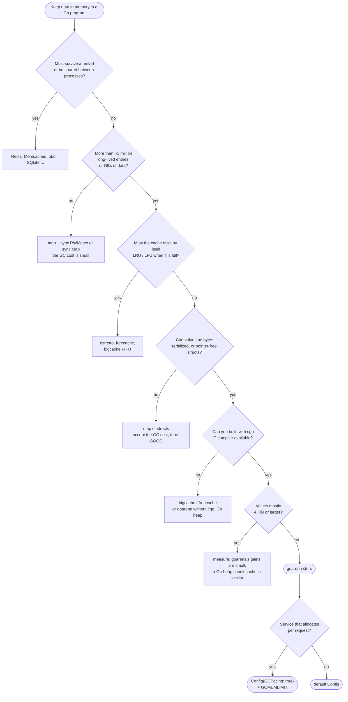

# When to use goarena - and when not

goarena solves one problem: **the garbage collector's work and the process
memory growing with the amount of long-lived data a Go program keeps in
memory.** It is very good at that and deliberately does nothing else (no
persistence, no eviction policy besides TTL, no distribution). This page helps
you decide whether it fits your workload. All numbers come from
[BENCHMARKS.md](BENCHMARKS.md) (one laptop, Windows 10, 16 goroutines, 90 %
reads, 20-byte keys, 128-byte values unless stated); measure your own
workload before deciding.

## Contents

- [Summary](#summary)
- [Decision flowchart](#decision-flowchart)
- [Good fits](#good-fits)
- [Poor fits](#poor-fits)
- [Alternatives at a glance](#alternatives-at-a-glance)

## Summary

| scenario | fit | why | alternative |
|---|---|---|---|
| [Large in-memory caches (1M - 100M+ entries)](#large-in-memory-caches-1m---100m-entries) | **good** | GC cost and RSS stop growing with the cache | - |
| [Session stores](#session-stores) | **good** | TTLs, small values, many entries | Redis if shared between instances |
| [Lookup and dictionary tables](#lookup-and-dictionary-tables) | **good** | large, read-mostly, loaded once | - |
| [Deduplication sets](#deduplication-sets) | **good** | ~50 bytes per key, lock-free `Has` | - |
| [Rate-limit counters with TTL](#rate-limit-counters-with-ttl) | good, with care | TTL per window; increments need your own lock | Redis `INCR` for shared limits |
| [Feature stores](#feature-stores) | **good** | read-heavy, latency-sensitive, fixed-size vectors | - |
| [Read-heavy hot-key workloads](#read-heavy-hot-key-workloads) | **good** | lock-free reads scale on one key | - |
| [Latency-sensitive services](#latency-sensitive-services) | **good** | no large GC cycles, low tail latency | - |
| [Memory-constrained containers](#memory-constrained-containers) | **good** | RSS close to the data size | - |
| [Small data sets (< ~100k entries)](#small-data-sets) | poor | the GC cost of a map is already small | `map` + `sync.RWMutex`, `sync.Map` |
| [Values with Go pointers / rich structs](#values-with-go-pointers-or-rich-structs) | poor | values must be serialized to bytes | `map` of structs, ristretto |
| [Persistence or transactions](#you-need-persistence-or-transactions) | no | memory only, lost on exit | bbolt, Badger, SQLite, Redis |
| [Eviction policies (LRU, LFU)](#you-need-an-eviction-policy-lru-lfu) | no | a full store returns `ErrNoMemory` | ristretto, freecache, golang-lru |
| [cgo-free builds that need the benefits](#cgo-free-builds-that-need-the-off-heap-benefits) | poor | without cgo the data is in the Go heap | bigcache, freecache |
| [Very large values (>= 4 KiB)](#very-large-values-4-kib-and-more) | marginal | copies dominate, gains vanish | bigcache, files/mmap, object store |
| [Short-lived data](#short-lived-data) | poor | the GC handles garbage that dies young cheaply | plain allocation, `sync.Pool` |
| [Value sizes that drift over time](#value-sizes-that-drift-over-time) | caution | memory is not returned to the OS before `Close` | periodic rebuild, bigcache |
| [Shared or distributed caches](#shared-or-distributed-caches) | no | in-process only | Redis, Memcached |

## Decision flowchart



---

## Good fits

### Large in-memory caches (1M - 100M+ entries)

**Why.** A `map[string][]byte` cache makes every GC cycle mark every key and
value. The cost of one full GC cycle grows with the number of entries for the
map, but stays below a millisecond for goarena:

| N | `map` | bigcache-style (`gobytes`) | goarena |
|---|---|---|---|
| 1 M | 26 ms | 0.6 ms | 0.27 ms |
| 10 M | 316 ms | 2.4 ms | 0.45 ms |
| 50 M | 12.5 s | 11.1 ms | 0.7 ms |

At 10 M entries goarena did 32.37 Mops/s with a p99.9 latency of 4.36 µs and
1797 MiB RSS (`map`: 23.36 Mops/s, 17.83 µs, 4050 MiB). At 50 M entries it
still did 25.57 Mops/s at 8.5 GiB RSS, against 18.40 Mops/s and 15.0 GiB for
the map.

**How.** Default `Config`, `InitialCapacity` if the final size is known,
`MaxMemory` if there is a budget, `GetInto` on the read path.

### Session stores

**Why.** Millions of small session records with a fixed lifetime are exactly
the long-lived, many-small-objects data that makes the GC expensive. TTLs are
built in: `Config.DefaultTTL` or `SetWithTTL` per session, expired sessions
are invisible immediately.

**How.**

```go
sessions := store.MustNew(store.Config{DefaultTTL: 30 * time.Minute, GCPacing: true})
defer sessions.Close()
go evictLoop(ctx, sessions, time.Minute) // see GUIDE.md, "Periodic eviction"

_ = sessions.SetString(sessionID, string(encodedSession))
data, ok := sessions.GetString(sessionID)
```

Sliding expiration means re-`Set` on access. If several instances of the
service must share sessions, use Redis instead (goarena is in-process).

### Lookup and dictionary tables

**Why.** Geo-IP ranges, product catalogs, translation tables, ID mappings:
large, loaded once or rarely, then read millions of times. Off-heap they cost
the GC nothing, and lock-free reads scale with cores.

**How.** `InitialCapacity` set to the number of entries avoids rehashing
during the load; read with `GetInto` (or `View` to decode in place). Reload by
building a new store and swapping an `atomic.Pointer[store.Store]`; close the
old store once no request uses it any more.

### Deduplication sets

**Why.** "Have I seen this ID?" over millions of IDs. A key with an empty
value costs `class(8 + len(key))` plus the index slot: about 24 + 27 ≈ 51
bytes for a 16-byte ID (see the formula in
[GUIDE.md](GUIDE.md#bytes-per-entry)), versus a Go map entry plus a string
header and its backing array that the GC must trace.

**How.** `s.Set(id, nil)` to record, `s.Has(id)` to check; `SetWithTTL` for a
dedup window (adds 8 bytes per entry). For an atomic "check and record" use
`GetOrSet(id, nil)`: `loaded == true` means the ID was seen before.

### Rate-limit counters with TTL

**Why.** One counter per client and time window, expiring with the window:
TTLs remove old windows without a sweep of your own.

**How - with care.** goarena has no atomic increment: `Get` followed by `Set`
is a read-modify-write that two goroutines can interleave. Guard increments of
the same key with your own striped lock, or accept approximate counts:

```go
type limiter struct {
	s     *store.Store
	locks [256]sync.Mutex
}

// allow counts one request of client in the current window.
func (l *limiter) allow(client string, limit uint64, window time.Duration) bool {
	key := fmt.Sprintf("%s:%d", client, time.Now().UnixNano()/int64(window))
	mu := &l.locks[crc32.ChecksumIEEE([]byte(key))%uint32(len(l.locks))]
	mu.Lock()
	defer mu.Unlock()
	var n uint64
	var buf [8]byte
	if v, ok := l.s.GetInto(buf[:0], []byte(key)); ok && len(v) == 8 {
		n = binary.LittleEndian.Uint64(v)
	}
	if n >= limit {
		return false
	}
	binary.LittleEndian.PutUint64(buf[:], n+1)
	_ = l.s.SetWithTTL([]byte(key), buf[:], window)
	return true
}
```

For limits shared between instances, use Redis (`INCR` + `EXPIRE`).

### Feature stores

**Why.** Per-entity feature vectors (embeddings, counters, scores) for online
inference: millions of fixed-size records, read on every request, where tail
latency matters.

**How.** Encode the vector as bytes (`encoding/binary` or
`math.Float32bits`) and decode it in place with `View` to avoid a copy, or use
`GetInto` with a per-request buffer. For a dense table indexed by an integer
ID, an `arena.NewSlice` of a pointer-free struct is even simpler (see
[GUIDE.md](GUIDE.md#typed-data-with-the-arena-package)).

### Read-heavy hot-key workloads

**Why.** Reads take no lock and write nothing to shared memory, so many
goroutines reading the same few keys do not contend. With a Zipf (s = 1.1)
key distribution at 5 M entries goarena did 48.66 Mops/s at a p99.9 of
1.0 µs; `sync.Map` 22.12 Mops/s (5.4 µs), `map` + RWMutex 18.61 Mops/s
(80.9 µs).

### Latency-sensitive services

**Why.** GC cycles stay small, so mark assists and pauses do not grow with the
cache. At 10 M entries the p99 latency was 0.90 µs and p99.9 4.36 µs, versus
1.94 / 17.83 µs for `map` and 2.55 / 21.59 µs for `sync.Map`. With 50 % writes
(N = 5 M) the p99.9 was 2.7 µs (`map`: 34.3 µs).

**Caveat.** Reads never block, so with as many busy goroutines as hardware
threads the operating system preempts threads now and then: about 10
operations per million took more than 1 ms with 16 goroutines on 16 hardware
threads (0.7 per million with 14 - 15 goroutines). Leave a core or two idle
if the extreme tail matters.

### Memory-constrained containers

**Why.** A heap-resident cache needs headroom for the GC (about twice the live
data with `GOGC=100`); goarena's data needs none. At 10 M entries the process
RSS was 1797 MiB versus 4050 MiB for `map` and 6538 MiB for `sync.Map`. In a
container budget (`GOMEMLIMIT = 1210 MiB` for every implementation, N = 5 M,
request garbage) goarena with `GCPacing` reached 9.17 Mops/s at 1132 MiB RSS;
`map` and `sync.Map` spent 55 - 74 % of the CPU time in the GC and managed
1.07 and 0.71 Mops/s.

**How.** `GCPacing: true`, `GOMEMLIMIT` at about 90 % of the container limit
and `MaxMemory` below it - see
[GUIDE.md, Containers and Kubernetes](GUIDE.md#containers-and-kubernetes).

---

## Poor fits

### Small data sets

**Why not.** With fewer than about 100 000 entries the live heap is small and
so is the GC's work; the benchmarks start at 1 M entries, where a full GC
cycle of a map took 26 ms - a cost that shrinks with the map. goarena then
mostly adds fixed costs: one 64 MiB chunk reserved per store with the default
`ChunkSize`, about 2 - 4 MiB of Go heap for 256 shards, and copies on every
read.

**Use instead.** `map` + `sync.RWMutex`, or `sync.Map` for read-mostly keys
that are written once.

### Values with Go pointers or rich structs

**Why not.** Off-heap memory must never contain Go pointers, so values are
bytes. Structs with strings, slices, maps or pointers must be serialized on
every write and deserialized on every read; for complex objects that can cost
more than the GC work you save.

**Use instead.** A map of structs (tune `GOGC`/`GOMEMLIMIT`), or
[ristretto](https://github.com/dgraph-io/ristretto), which stores arbitrary
Go values. Pointer-free structs (numbers and fixed-size arrays only) are fine:
put them in an arena with `arena.NewSlice` / `arena.NewValue`.

### You need persistence or transactions

**Why not.** goarena is an in-memory store: everything is gone after `Close`
or a crash, and there are no transactions, snapshots or iteration order.

**Use instead.** [bbolt](https://github.com/etcd-io/bbolt),
[Badger](https://github.com/dgraph-io/badger), SQLite, or Redis with
persistence.

### You need an eviction policy (LRU, LFU)

**Why not.** Besides TTLs goarena never removes entries by itself. A store
that reaches `MaxMemory` returns `ErrNoMemory` and keeps everything.

**Use instead.** [ristretto](https://github.com/dgraph-io/ristretto) (TinyLFU
admission, cost-based), [freecache](https://github.com/coocood/freecache)
(approximate LRU, pointer-free Go heap),
[bigcache](https://github.com/allegro/bigcache) (FIFO per shard),
[golang-lru](https://github.com/hashicorp/golang-lru) (exact LRU for small
caches).

### cgo-free builds that need the off-heap benefits

**Why not.** Without cgo, goarena falls back to pointer-free blocks in the Go
heap: it builds and works, the GC still does not scan the data, but the bytes
count towards the heap goal and `GOMEMLIMIT`, so the memory and pacing
benefits are gone. That is essentially the technique of bigcache and freecache.

**Use instead.** bigcache or freecache if you cannot use cgo at all; otherwise
build with cgo (cross-compilers, Docker builds - see
[TROUBLESHOOTING.md](TROUBLESHOOTING.md#cross-compilation)).

### Very large values (4 KiB and more)

**Why not.** With large values the per-entry GC cost matters less and copying
dominates. At 2 M entries with 4 KiB values goarena did 6.75 Mops/s against
6.32 for the bigcache-style cache, but used 4.2 % more memory (8413 vs 8070
MiB). Values above 64 KiB are rounded up to large size classes (up to 25 %),
and `Get` copies the whole value (`View` avoids the copy but holds the shard
lock).

**Use instead.** Measure: bigcache/freecache behave similarly; for very large
blobs keep them in files (`mmap`) or an object store and cache only metadata.

### Short-lived data

**Why not.** Data that dies within a request is cheap for the GC (it is never
marked if it is unreachable when a cycle starts). Putting it off-heap adds
copies and explicit lifetime management for nothing.

**Use instead.** Plain allocation, `sync.Pool` for buffers. For batch-scoped
scratch memory of pointer-free data, an `arena.Arena` with `Reset` per batch
can help.

### Value sizes that drift over time

**Why caution.** Freed blocks are reused only by entries of the same size
class, and memory is not returned to the operating system before `Close`. A
workload whose value sizes shift over time (for example, values that grow
slowly) leaves the old classes' memory on free lists (`Stats.FreeListBytes`).

**Use instead.** Rebuild the store periodically (new store, copy with `Range`,
swap, close the old one), or use a cache that compacts, such as bigcache.

### Shared or distributed caches

**Why not.** A store lives inside one process. It does not replicate, shard
across machines or survive deployments.

**Use instead.** Redis, Memcached, or groupcache-style libraries. goarena can
still serve as the local, in-process tier in front of them (`GetOrLoad` with a
loader that queries Redis).

---

## Alternatives at a glance

| | goarena | `map` + mutex | `sync.Map` | bigcache / freecache | ristretto | Redis |
|---|---|---|---|---|---|---|
| data scanned by the GC | no | yes | yes | no (pointer-free) | yes | n/a (other process) |
| counted by GOGC / GOMEMLIMIT | no (cgo) | yes | yes | yes | yes | n/a |
| values | bytes | any | any | bytes | any | bytes |
| eviction | TTL only | none | none | FIFO / approx. LRU, TTL | TinyLFU, TTL | many policies |
| needs cgo | yes (falls back without) | no | no | no | no | no |
| persistence, sharing | no | no | no | no | no | yes |
| explicit `Close` required | **yes** | no | no | no | no | client |
